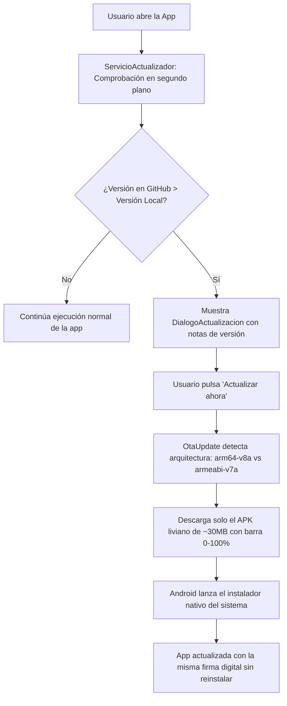

# GitHub In-App Auto-Updater para Flutter (Android)

Skill completa y modular para integrar un **sistema de auto-actualizaciones directas dentro de cualquier app Flutter en Android**, utilizando **GitHub Releases** como servidor gratuito e ilimitado de distribución de APKs y **GitHub Actions** para compilar automáticamente en la nube.

Elimina por completo la necesidad de compilar APKs en la computadora local y enviarlos manualmente por WhatsApp, Drive o correo.

---

## 🏗️ 1. Arquitectura General y Flujo de Actualización



---

## 📁 2. Mapa de Archivos a Copiar en tu Proyecto

Para replicar esta funcionalidad en cualquier proyecto Flutter, estos son los archivos involucrados:

```
tu_proyecto/
├── .github/
│   └── workflows/
│       └── publicar_release.yml          # Compilación automática en la nube (Split per ABI)
├── android/
│   ├── app/
│   │   ├── release.keystore              # Clave de firma fija (evita error de firma no coincidente)
│   │   ├── build.gradle.kts (o .gradle)  # Configuración de desugaring 2.1.4 y signingConfigs
│   │   └── src/main/
│   │       ├── AndroidManifest.xml       # Permisos de instalación y FileProvider de OTA
│   │       └── res/xml/filepaths.xml     # Ruta interna segura para el APK descargado
│   └── .gitignore                        # Des-ignorar !app/release.keystore
├── lib/
│   ├── modelos/
│   │   └── modelo_info_actualizacion.dart# Modelo inmutable de datos del Release
│   ├── servicios/
│   │   └── servicio_actualizador.dart    # Lógica de API GitHub, SemVer y filtro por chip
│   └── widgets/
│       └── dialogo_actualizacion.dart    # Diálogo UI con notas y barra de progreso 0-100%
├── publicar.ps1                          # Script de 1 solo comando para lanzar releases
└── pubspec.yaml                          # Dependencias requeridas
```

---

## 📦 3. Dependencias en `pubspec.yaml`

Agrega estas 3 librerías bajo `dependencies:`:

```yaml
dependencies:
  flutter:
    sdk: flutter

  # Lee la versión local actual instalada (ej: 1.0.0)
  package_info_plus: ^8.1.0

  # Consulta la API REST pública de GitHub Releases
  http: ^1.2.2

  # Descarga el APK con progreso y dispara el instalador nativo de Android
  ota_update: ^7.1.0

  # Evita consultar la API en cada reinicio (caché de 4 horas)
  shared_preferences: ^2.3.3
```

---

## 🤖 4. Configuración Nativa de Android

### A. Permisos y FileProvider en `android/app/src/main/AndroidManifest.xml`

Agrega los permisos bajo la etiqueta `<manifest>`:
```xml
    <!-- Permisos para auto-actualizaciones OTA -->
    <uses-permission android:name="android.permission.INTERNET" />
    <uses-permission android:name="android.permission.REQUEST_INSTALL_PACKAGES" />
```

Y dentro de la etiqueta `<application>`:
```xml
        <!-- Proveedor de archivos para instalación segura del APK -->
        <provider
            android:name="sk.fourq.otaupdate.OtaUpdateFileProvider"
            android:authorities="${applicationId}.ota_update_provider"
            android:exported="false"
            android:grantUriPermissions="true">
            <meta-data
                android:name="android.support.FILE_PROVIDER_PATHS"
                android:resource="@xml/filepaths" />
        </provider>

        <!-- Receptor de finalización de instalación -->
        <receiver
            android:name="sk.fourq.otaupdate.InstallResultReceiver"
            android:exported="false">
            <intent-filter>
                <action android:name="${applicationId}.ACTION_INSTALL_COMPLETE"/>
            </intent-filter>
        </receiver>
```

### B. Crear `android/app/src/main/res/xml/filepaths.xml`

```xml
<?xml version="1.0" encoding="utf-8"?>
<paths xmlns:android="http://schemas.android.com/apk/res/android">
    <files-path name="internal_apk_storage" path="ota_update/"/>
</paths>
```

### C. Clave de Firma Fija (`release.keystore`)
> ⚠️ **CRÍTICO:** En Android, una app jamás se puede actualizar sobre sí misma si la firma cambia. Para que los APKs generados en tu PC y los generados en GitHub Actions tengan la misma firma idéntica, genera una clave fija:

Ejecuta en PowerShell:
```powershell
& "C:\Program Files\Android\Android Studio\jbr\bin\keytool.exe" -genkey -v -keystore android/app/release.keystore -alias tuapp -keyalg RSA -keysize 2048 -validity 10000 -storepass tuclave123 -keypass tuclave123 -dname "CN=TuApp, OU=App, O=TuUsuario, C=ES"
```

Asegúrate de permitir que Git suba esta clave agregando a `android/.gitignore`:
```gitignore
key.properties
**/*.keystore
!app/release.keystore
**/*.jks
```

### D. Configurar `android/app/build.gradle.kts` (o Groovy)

En **Kotlin DSL (`build.gradle.kts`)**:
```kotlin
android {
    ...
    compileOptions {
        isCoreLibraryDesugaringEnabled = true // Exigido por ota_update 7.1.0+
        sourceCompatibility = JavaVersion.VERSION_17
        targetCompatibility = JavaVersion.VERSION_17
    }

    signingConfigs {
        create("release") {
            storeFile = file("release.keystore")
            storePassword = "tuclave123"
            keyAlias = "tuapp"
            keyPassword = "tuclave123"
        }
    }

    buildTypes {
        release {
            signingConfig = signingConfigs.getByName("release")
        }
    }
}

dependencies {
    // Versión 2.1.4 o superior obligatoria para ota_update 7.1.0
    coreLibraryDesugaring("com.android.tools:desugar_jdk_libs:2.1.4")
}
```

*(Si usas el formato clásico `build.gradle` en Groovy, la sintaxis equivalente es `coreLibraryDesugaringEnabled true` y `coreLibraryDesugaring 'com.android.tools:desugar_jdk_libs:2.1.4'`).*

---

## 💻 5. Código Dart / Flutter

### A. Modelo (`lib/modelos/modelo_info_actualizacion.dart`)
```dart
/// Modelo inmutable con la información de una versión disponible en GitHub Releases.
class ModeloInfoActualizacion {
  final String versionRemota;
  final String versionActual;
  final String notasCambios;
  final String urlDescargaApk;
  final String nombreArchivo;
  final int? tamanoBytes;
  final bool hayNuevaVersion;

  const ModeloInfoActualizacion({
    required this.versionRemota,
    required this.versionActual,
    required this.notasCambios,
    required this.urlDescargaApk,
    required this.nombreArchivo,
    this.tamanoBytes,
    required this.hayNuevaVersion,
  });

  String get tamanoLegible {
    if (tamanoBytes == null || tamanoBytes! <= 0) return '';
    final megas = tamanoBytes! / (1024 * 1024);
    return '${megas.toStringAsFixed(1)} MB';
  }
}
```

### B. Servicio (`lib/servicios/servicio_actualizador.dart`)
```dart
import 'dart:convert';
import 'package:flutter/foundation.dart';
import 'package:http/http.dart' as http;
import 'package:ota_update/ota_update.dart';
import 'package:package_info_plus/package_info_plus.dart';
import 'package:shared_preferences/shared_preferences.dart';
import '../modelos/modelo_info_actualizacion.dart';

class ServicioActualizador {
  // CONFIGURAR ESTOS DOS VALORES PARA TU REPOSITORIO DE GITHUB
  static const String usuarioGitHub = 'TU_USUARIO';
  static const String repositorioGitHub = 'TU_REPOSITORIO';

  static const String _prefUltimoChequeo = 'timestamp_ultimo_chequeo_update';

  static Future<ModeloInfoActualizacion?> verificarActualizacion({
    bool forzar = false,
  }) async {
    try {
      final prefs = await SharedPreferences.getInstance();

      if (!forzar) {
        final ultimoChequeo = prefs.getInt(_prefUltimoChequeo) ?? 0;
        final ahora = DateTime.now().millisecondsSinceEpoch;
        const cuatroHorasMs = 4 * 60 * 60 * 1000;

        if (ahora - ultimoChequeo < cuatroHorasMs) {
          return null; // Aún en periodo de enfriamiento
        }
      }

      final packageInfo = await PackageInfo.fromPlatform();
      final versionActual = packageInfo.version;

      final url = Uri.parse(
        'https://api.github.com/repos/$usuarioGitHub/$repositorioGitHub/releases/latest',
      );

      final respuesta = await http.get(
        url,
        headers: {
          'Accept': 'application/vnd.github.v3+json',
          'User-Agent': 'FlutterApp-Updater',
        },
      ).timeout(const Duration(seconds: 10));

      await prefs.setInt(_prefUltimoChequeo, DateTime.now().millisecondsSinceEpoch);

      if (respuesta.statusCode != 200) return null;

      final data = jsonDecode(respuesta.body) as Map<String, dynamic>;
      final rawTag = (data['tag_name'] as String? ?? '').trim();
      final versionRemota = rawTag.replaceAll(RegExp(r'^[vV]'), '');

      if (versionRemota.isEmpty) return null;

      final notas = (data['body'] as String?)?.trim() ?? 'Mejoras y correcciones generales.';

      // Detección de chip/arquitectura nativa (arm64-v8a vs armeabi-v7a)
      String? abiPreferida;
      try {
        abiPreferida = await OtaUpdate().getAbi();
      } catch (_) {
        abiPreferida = null;
      }

      final assets = data['assets'] as List<dynamic>? ?? [];
      String? urlApk;
      String nombreArchivo = 'app-update.apk';
      int? tamanoBytes;

      // 1. Coincidencia por arquitectura (APK ligero de ~30MB)
      if (abiPreferida != null && abiPreferida.isNotEmpty) {
        final abi = abiPreferida.toLowerCase();
        for (final asset in assets) {
          final nombre = (asset['name'] as String? ?? '').toLowerCase();
          if (nombre.endsWith('.apk') && nombre.contains(abi)) {
            urlApk = asset['browser_download_url'] as String?;
            nombreArchivo = asset['name'] as String? ?? nombreArchivo;
            tamanoBytes = asset['size'] as int?;
            break;
          }
        }
      }

      // 2. Fallback general (APK universal o primero encontrado)
      if (urlApk == null) {
        for (final asset in assets) {
          final nombre = (asset['name'] as String? ?? '').toLowerCase();
          if (nombre.endsWith('.apk')) {
            urlApk = asset['browser_download_url'] as String?;
            nombreArchivo = asset['name'] as String? ?? nombreArchivo;
            tamanoBytes = asset['size'] as int?;
            break;
          }
        }
      }

      if (urlApk == null || urlApk.isEmpty) return null;

      final hayNueva = esVersionMayor(versionRemota, versionActual);

      return ModeloInfoActualizacion(
        versionRemota: versionRemota,
        versionActual: versionActual,
        notasCambios: notas,
        urlDescargaApk: urlApk,
        nombreArchivo: nombreArchivo,
        tamanoBytes: tamanoBytes,
        hayNuevaVersion: hayNueva,
      );
    } catch (e) {
      debugPrint('[ServicioActualizador] Error al comprobar actualización: $e');
      return null;
    }
  }

  static bool esVersionMayor(String versionRemota, String versionLocal) {
    try {
      String limpiar(String v) =>
          v.replaceAll(RegExp(r'^[vV]'), '').split('+').first.split('-').first.trim();
      final partesRemota = limpiar(versionRemota).split('.').map((e) => int.tryParse(e) ?? 0).toList();
      final partesLocal = limpiar(versionLocal).split('.').map((e) => int.tryParse(e) ?? 0).toList();

      final maxLong = partesRemota.length > partesLocal.length ? partesRemota.length : partesLocal.length;

      for (int i = 0; i < maxLong; i++) {
        final r = i < partesRemota.length ? partesRemota[i] : 0;
        final l = i < partesLocal.length ? partesLocal[i] : 0;
        if (r > l) return true;
        if (r < l) return false;
      }
      return false;
    } catch (_) {
      return false;
    }
  }
}
```

### C. Diálogo UI (`lib/widgets/dialogo_actualizacion.dart`)
```dart
import 'dart:async';
import 'package:flutter/material.dart';
import 'package:ota_update/ota_update.dart';
import '../modelos/modelo_info_actualizacion.dart';

class DialogoActualizacion extends StatefulWidget {
  final ModeloInfoActualizacion info;
  const DialogoActualizacion({super.key, required this.info});

  static Future<void> mostrar(BuildContext context, {required ModeloInfoActualizacion info}) {
    return showDialog<void>(
      context: context,
      barrierDismissible: false,
      builder: (_) => DialogoActualizacion(info: info),
    );
  }

  @override
  State<DialogoActualizacion> createState() => _DialogoActualizacionState();
}

class _DialogoActualizacionState extends State<DialogoActualizacion> {
  StreamSubscription<OtaEvent>? _subscripcion;
  bool _descargando = false;
  double _progreso = 0.0;
  String _estadoMensaje = '';
  String? _errorMensaje;

  @override
  void dispose() {
    _subscripcion?.cancel();
    super.dispose();
  }

  void _iniciarActualizacion() {
    setState(() {
      _descargando = true;
      _errorMensaje = null;
      _progreso = 0.0;
      _estadoMensaje = 'Conectando con el servidor...';
    });

    try {
      _subscripcion = OtaUpdate()
          .execute(widget.info.urlDescargaApk, destinationFilename: widget.info.nombreArchivo)
          .listen(
            (OtaEvent event) {
              if (!mounted) return;
              switch (event.status) {
                case OtaStatus.DOWNLOADING:
                  final p = double.tryParse(event.value ?? '0') ?? 0.0;
                  setState(() {
                    _progreso = (p / 100.0).clamp(0.0, 1.0);
                    _estadoMensaje = 'Descargando: ${p.toInt()}%';
                  });
                  break;
                case OtaStatus.INSTALLING:
                  setState(() {
                    _progreso = 1.0;
                    _estadoMensaje = 'Abriendo instalador del sistema...';
                  });
                  break;
                case OtaStatus.INSTALLATION_DONE:
                  setState(() => _estadoMensaje = 'Instalación finalizada.');
                  break;
                case OtaStatus.INSTALLATION_ERROR:
                  setState(() {
                    _descargando = false;
                    _errorMensaje = 'No se pudo instalar el APK. Verifica compatibilidad.';
                  });
                  break;
                case OtaStatus.PERMISSION_NOT_GRANTED_ERROR:
                  setState(() {
                    _descargando = false;
                    _errorMensaje = 'Permiso denegado para instalar aplicaciones desconocidas.';
                  });
                  break;
                case OtaStatus.DOWNLOAD_ERROR:
                  setState(() {
                    _descargando = false;
                    _errorMensaje = 'Error de conexión al descargar el archivo.';
                  });
                  break;
                case OtaStatus.INTERNAL_ERROR:
                  setState(() {
                    _descargando = false;
                    _errorMensaje = 'Error interno: ${event.value ?? ""}';
                  });
                  break;
                case OtaStatus.ALREADY_RUNNING_ERROR:
                  setState(() => _estadoMensaje = 'Descarga en curso...');
                  break;
                case OtaStatus.CHECKSUM_ERROR:
                  setState(() {
                    _descargando = false;
                    _errorMensaje = 'Error de integridad en el archivo descargado.';
                  });
                  break;
                case OtaStatus.CANCELED:
                  setState(() {
                    _descargando = false;
                    _estadoMensaje = 'Descarga cancelada.';
                  });
                  break;
              }
            },
            onError: (dynamic error) {
              if (!mounted) return;
              setState(() {
                _descargando = false;
                _errorMensaje = 'Error en actualización: $error';
              });
            },
          );
    } catch (e) {
      if (!mounted) return;
      setState(() {
        _descargando = false;
        _errorMensaje = 'Excepción al descargar: $e';
      });
    }
  }

  @override
  Widget build(BuildContext context) {
    final tamano = widget.info.tamanoLegible;
    return Dialog(
      shape: RoundedRectangleBorder(borderRadius: BorderRadius.circular(20)),
      child: Padding(
        padding: const EdgeInsets.all(20),
        child: Column(
          mainAxisSize: MainAxisSize.min,
          crossAxisAlignment: CrossAxisAlignment.stretch,
          children: [
            Row(
              children: [
                const Icon(Icons.system_update_rounded, size: 28, color: Colors.blueAccent),
                const SizedBox(width: 12),
                Expanded(
                  child: Column(
                    crossAxisAlignment: CrossAxisAlignment.start,
                    children: [
                      const Text('Nueva versión disponible', style: TextStyle(fontWeight: FontWeight.bold, fontSize: 16)),
                      Text('v${widget.info.versionActual} ➜ v${widget.info.versionRemota}${tamano.isNotEmpty ? " ($tamano)" : ""}',
                          style: const TextStyle(fontSize: 13, color: Colors.grey)),
                    ],
                  ),
                ),
              ],
            ),
            const SizedBox(height: 16),
            const Text('Novedades:', style: TextStyle(fontWeight: FontWeight.w600, fontSize: 13)),
            const SizedBox(height: 6),
            Container(
              constraints: const BoxConstraints(maxHeight: 160),
              padding: const EdgeInsets.all(12),
              decoration: BoxDecoration(color: Colors.black12, borderRadius: BorderRadius.circular(10)),
              child: SingleChildScrollView(child: Text(widget.info.notasCambios, style: const TextStyle(fontSize: 13))),
            ),
            const SizedBox(height: 16),
            if (_descargando) ...[
              LinearProgressIndicator(value: _progreso > 0 ? _progreso : null),
              const SizedBox(height: 8),
              Text(_estadoMensaje, textAlign: TextAlign.center, style: const TextStyle(fontSize: 12)),
              const SizedBox(height: 12),
            ],
            if (_errorMensaje != null) ...[
              Text(_errorMensaje!, style: const TextStyle(color: Colors.red, fontSize: 12)),
              const SizedBox(height: 12),
            ],
            Row(
              mainAxisAlignment: MainAxisAlignment.end,
              children: [
                if (!_descargando)
                  TextButton(onPressed: () => Navigator.pop(context), child: const Text('Más tarde')),
                const SizedBox(width: 8),
                ElevatedButton(
                  onPressed: _descargando ? null : _iniciarActualizacion,
                  child: Text(_descargando ? 'Descargando...' : 'Actualizar ahora'),
                ),
              ],
            ),
          ],
        ),
      ),
    );
  }
}
```

---

## ☁️ 6. Workflow de GitHub Actions (`.github/workflows/publicar_release.yml`)

Crea este archivo en la raíz del proyecto para compilar automáticamente en la nube sin usar tu PC:

```yaml
name: Publicar Release con APK

on:
  push:
    tags:
      - 'v*'
  workflow_dispatch:
    inputs:
      tag_name:
        description: 'Versión (ej: v1.0.1)'
        required: true
        default: 'v1.0.1'
      release_notes:
        description: 'Novedades / Notas de versión'
        required: false
        default: 'Mejoras y correcciones.'

permissions:
  contents: write

jobs:
  build-and-release:
    name: Compilar APK y Publicar en GitHub
    runs-on: ubuntu-latest

    steps:
      - name: Clonar código
        uses: actions/checkout@v4

      - name: Configurar Java 17
        uses: actions/setup-java@v4
        with:
          distribution: 'temurin'
          java-version: '17'

      - name: Configurar Flutter
        uses: subosito/flutter-action@v2
        with:
          channel: 'stable'
          cache: true

      - name: Instalar dependencias
        run: flutter pub get

      - name: Compilar APKs por Arquitectura (Split per ABI)
        run: flutter build apk --split-per-abi --release

      - name: Renombrar APKs con la versión
        run: |
          TAG="${{ github.event.inputs.tag_name || github.ref_name }}"
          cp build/app/outputs/flutter-apk/app-arm64-v8a-release.apk "build/app/outputs/flutter-apk/app-${TAG}-arm64-v8a.apk"
          cp build/app/outputs/flutter-apk/app-armeabi-v7a-release.apk "build/app/outputs/flutter-apk/app-${TAG}-armeabi-v7a.apk"
          cp build/app/outputs/flutter-apk/app-x86_64-release.apk "build/app/outputs/flutter-apk/app-${TAG}-x86_64.apk"

      - name: Crear Release y Subir APKs
        uses: softprops/action-gh-release@v2
        with:
          tag_name: ${{ github.event.inputs.tag_name || github.ref_name }}
          name: ${{ github.event.inputs.tag_name || github.ref_name }}
          body: ${{ github.event.inputs.release_notes || 'Nueva actualización disponible.' }}
          draft: false
          prerelease: false
          files: |
            build/app/outputs/flutter-apk/app-*.apk
        env:
          GITHUB_TOKEN: ${{ secrets.GITHUB_TOKEN }}
```

---

## ⚡ 7. Script de Publicación en 1 Comando (`publicar.ps1`)

Coloca este script en la raíz de tu proyecto para lanzar versiones desde PowerShell en Windows:

```powershell
param (
    [Parameter(Mandatory=$true, Position=0)]
    [string]$Version,

    [Parameter(Mandatory=$false, Position=1)]
    [string]$Notas = "Mejoras de rendimiento y correccion de errores."
)

$tag = $Version
if (-not ($tag.StartsWith("v") -or $tag.StartsWith("V"))) {
    $tag = "v" + $Version
}

$versionPura = $tag.Substring(1).Split('+')[0]

Write-Host ""
Write-Host "Iniciando publicacion automatica para $tag..." -ForegroundColor Cyan

# 1. Actualizar version en pubspec.yaml
$pubspecPath = "pubspec.yaml"
if (Test-Path $pubspecPath) {
    $contenido = [IO.File]::ReadAllText($pubspecPath)
    $versionNueva = "version: " + $versionPura + "+1"
    $contenidoNuevo = $contenido -replace 'version:\s*[0-9\.\+\-]+', $versionNueva
    [IO.File]::WriteAllText($pubspecPath, $contenidoNuevo)
    Write-Host "[OK] pubspec.yaml actualizado a version: $versionPura+1" -ForegroundColor Green
}

# 2. Guardar cambios en git
Write-Host "Guardando cambios en Git..." -ForegroundColor Cyan
git add .

# 3. Crear commit
git commit -m "chore(release): version $tag - $Notas"
Write-Host "[OK] Commit creado exitosamente" -ForegroundColor Green

# 4. Crear etiqueta de release
git tag -a $tag -m "$Notas"
Write-Host "[OK] Etiqueta $tag creada" -ForegroundColor Green

# 5. Enviar a GitHub
Write-Host "Subiendo cambios y etiqueta a GitHub..." -ForegroundColor Cyan
git push origin master
git push origin $tag

Write-Host ""
Write-Host "================================================================" -ForegroundColor Green
Write-Host "EXITO! Se ha lanzado la publicacion de $tag." -ForegroundColor Green
Write-Host "GitHub Actions esta compilando el APK en la nube en este momento." -ForegroundColor Yellow
Write-Host "En aproximadamente 2 minutos estara disponible en GitHub Releases" -ForegroundColor Yellow
Write-Host "y tu telefono mostrara la ventana para actualizar." -ForegroundColor Yellow
Write-Host "================================================================" -ForegroundColor Green
```

---

## 🛡️ 8. Checklist Antierrores (Troubleshooting)

| Problema | Causa | Solución |
| :--- | :--- | :--- |
| **Error `INSTALL_FAILED_UPDATE_INCOMPATIBLE` ("No se pudo instalar")** | Las firmas de la app instalada y del APK descargado son diferentes. | Usa el archivo `release.keystore` idéntico tanto localmente como en GitHub Actions. La primera vez, desinstala la app anterior del teléfono. |
| **El APK descargado pesa 90MB en vez de 30MB** | Falta compilar con `--split-per-abi`. | Usa siempre `--split-per-abi` en el workflow de GitHub Actions y filtra por `OtaUpdate().getAbi()` en el servicio. |
| **Error de Gradle `desugar_jdk_libs version to be 2.1.4 or above`** | `ota_update 7.1.0` requiere desugaring moderno. | Pon `coreLibraryDesugaring("com.android.tools:desugar_jdk_libs:2.1.4")` en `build.gradle.kts`. |
| **GitHub API devuelve 404 (Not Found)** | El repositorio de GitHub es privado. | Haz el repositorio **Público** (Settings -> Change repository visibility -> Make public) para permitir descargas anónimas sin tokens. |
| **Error de parser en PowerShell (`MissingEndCurlyBrace`)** | Scripts `.ps1` con caracteres Unicode / emojis en PowerShell 5.1. | Mantén los scripts PowerShell en ASCII limpio sin emojis multibyte. |

